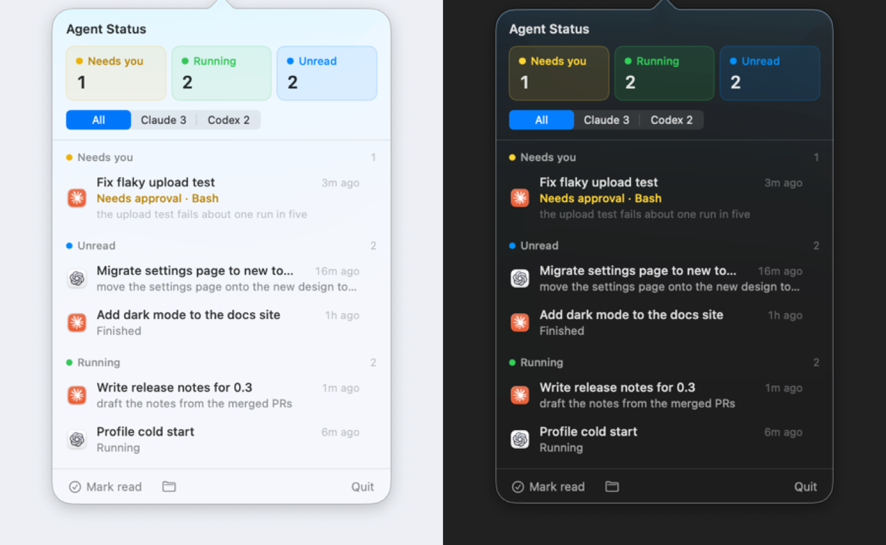
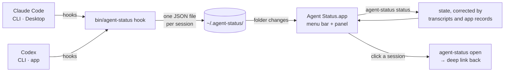

<div align="center">

# Agent Status

**A tiny macOS menu bar light for your Claude Code and Codex sessions.**

See at a glance which sessions need you, which are still working, and which finished while you were away. Click one to jump straight back to it.


</div>

## What the lights mean

| | Counts sessions that… |
|---|---|
| 🟡 **Needs you** | wait for you: a permission to approve, a question to answer, a plan to review |
| 🟢 **Running** | are working right now |
| 🔵 **Unread** | finished, and you haven't looked yet |

Sessions you've already seen, and interrupted ones, drop off on their own.

## The panel

Click the badge to open the panel:

<p align="center">
  
</p>

- **Three status tiles** with the counts. Click a tile to show only that state; click it again for all.
- **All · Claude · Codex** filter, with how many sessions each has.
- **Session cards**, grouped with what needs you first: the app's icon, the session title (from Claude Desktop or Codex), what it's doing, how long ago, and your last prompt.
- **Click a card to jump back** to that exact session in Claude Code Desktop or the Codex app, or to the terminal it runs in. Its blue light goes out.
- **Mark read** clears every blue light at once.

The panel follows your macOS appearance (light or dark) and language (English or Chinese).

## Install

You need:

- macOS 13 or later, with the Xcode Command Line Tools (`xcode-select --install`), which bring `/usr/bin/python3` and `swiftc`
- Claude Code (CLI or Desktop) and/or Codex (CLI 0.169+ or the Codex app)

```sh
git clone https://github.com/Handsomemikezzz/agent-monitor.git ~/agent-status
~/agent-status/install.sh
```

`install.sh`:

1. Adds hooks to `~/.claude/settings.json` and `~/.codex/hooks.json`. It backs up each file first and leaves your other hooks alone, so you can run it again safely.
2. Builds the menu bar app into `build/Agent Status.app` and starts it, now and at every login, through a LaunchAgent (`~/Library/LaunchAgents/io.github.agent-status.plist`). **Quit** in the panel keeps it closed until you log in again.
3. Asks you to trust the hooks in Codex (see below).

**Codex hooks need your trust.** Codex runs a new hook only after you trust it, and it doesn't prompt you on its own. When `install.sh` runs in a terminal, it lists the hooks and asks `[y/N]`. To do it later:

```sh
~/agent-status/bin/agent-status trust-codex
```

This uses the same `codex app-server` API as the Codex app's **Settings → Hooks → Review hooks** page, so you can trust them there instead. If a hook changes, Codex asks again.

To remove everything (hooks, app, login item):

```sh
~/agent-status/uninstall.sh
```

## How it works



There's no daemon and no polling of the agents. Their own hooks write one small JSON file per session. The menu bar app watches that folder and redraws as soon as a file changes. When you open the panel, and every 30 seconds, it also checks what the apps themselves recorded, which catches what hooks can't see.

**Hooks give the live signal:**

| Event | Claude Code | Codex | Light |
|---|---|---|---|
| prompt sent | `UserPromptSubmit` | same | 🟢 running |
| approval or question | `PermissionRequest`, `PreToolUse` (AskUserQuestion / ExitPlanMode), `Notification` | `PermissionRequest` | 🟡 needs you |
| tool finished after approval | `PostToolUse` | `PostToolUse` | 🟢 running |
| turn finished | `Stop` | `Stop` | 🔵 unread, until seen |
| interrupted | – | `Interrupt` | off |
| session closed | `SessionEnd` (CLI) · archived (Desktop) | `SessionEnd` (CLI) · archived (app) | off |

The Claude and Codex apps send `SessionEnd` every time they quit and `SessionStart` when they reopen a session, so for app sessions neither changes the state; archiving does.

Only sessions you started are counted. The Codex app also runs short internal sessions of its own (summaries, safety review) that fire the same hooks but have no transcript and no thread you could open, and Codex subagents get threads of their own; both are skipped.

**Some changes send no hook at all:** pressing Esc in Claude Code, denying an approval, or a session that hasn't fired a hook since you installed. So for recently active sessions the app also reads:

- **The end of each transcript** (`~/.claude/projects/…`, `~/.codex/sessions/…`): did the last turn finish, get interrupted, or is it still going? When the transcript is newer than the last hook event, it wins. Approvals and questions only ever come from hooks.
- **Claude Desktop's session files** (`~/Library/Application Support/Claude/claude-code-sessions/`): the title, whether it's archived, and when you last opened it. A finished session you've opened since counts as seen.
- **Codex's state database** (`~/.codex/state_*.sqlite`, read-only): the thread title, whether it's archived, and the Codex app's own read/unread mark.

A blue light goes out when you click the session in the panel, open it in the app, or send it a new message. Yellow and blue sessions nobody looks at are cleared after 24 hours. A running session with no sign of life for 30 minutes stops counting as running.

**Jump targets** are worked out when a hook fires:

- Claude Code Desktop: `claude://claude.ai/epitaxy/<local session id>`
- Codex app: `codex://threads/<thread id>`
- Terminal sessions: the terminal app that started them

These deep links aren't documented by either app. If one stops working, clicking still brings the app forward.

## Privacy

Everything stays on your Mac. Agent Status makes no network requests. It reads the agents' local files read-only. It writes only to `~/.agent-status/`, its LaunchAgent, the hook entries in the two settings files above (with backups), and, once you agree, Codex's trust record for those hooks in `~/.codex/config.toml`.

## Commands

```sh
bin/agent-status status      # the sessions the panel shows, as JSON
bin/agent-status dump        # every stored record, as JSON
bin/agent-status seen-all    # mark every finished session as seen
bin/agent-status trust-codex # trust the hooks in Codex
bin/agent-status uninstall   # remove the hooks and the menu bar app
/usr/bin/python3 tests/test_states.py   # state transition tests
```

To debug the hooks, `touch ~/.agent-status/.debug`. Every event is then appended to `~/.agent-status/debug.log`, with prompts and tool output replaced by their length. Delete `.debug` to stop.

## Project layout

```
bin/agent-status     hooks, state, jump, install: one Python file, standard library only
app/main.swift       the menu bar app (SwiftUI + AppKit), built by install.sh
tests/               state transition tests
DESIGN.md            design notes (in Chinese)
```

## Known limits

- Esc and denied approvals in Claude Code send no hook, so those changes show up within 30 seconds rather than at once.
- If a Desktop session finishes while it's on screen but Claude isn't the front app, it counts as unread until you switch to it.
- Transcript formats, Desktop's session files and Codex's database are the apps' internals and may change. If they can't be read, you lose the corrections; the hooks keep working.
- The app is built and ad-hoc signed on your Mac by `install.sh`. There's no notarized download.
