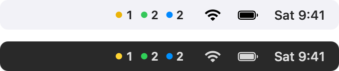

<div align="center">

# Agent Status

A macOS menu bar indicator for Claude Code, Codex and Antigravity sessions.




</div>

The badge shows how many sessions are in each state:

| | |
|---|---|
| 🟡 **Needs you** | waiting for an approval, an answer or a plan review |
| 🟢 **Running** | working right now |
| 🔵 **Unread** | finished, and you haven't looked at it yet |

Click the badge to open the panel. Click a session to jump back to it in Claude Code Desktop, the Codex app, Antigravity, or the terminal it runs in.

<p align="center">
  
</p>

In the panel you can:

- click a status tile to show only that state
- filter by agent, when more than one has sessions
- clear every unread session with **Mark read**

The panel follows your system appearance and language (English or Chinese).

## Requirements

- macOS 13 or later
- Xcode Command Line Tools (`xcode-select --install`), for `python3` and `swiftc`
- Any of: Claude Code (CLI or Desktop), Codex (CLI 0.169+ or app), Antigravity (2.34+)

## Install

```sh
git clone https://github.com/Handsomemikezzz/agent-monitor.git ~/agent-status
~/agent-status/install.sh
```

The install script:

1. Adds hooks to `~/.claude/settings.json`, `~/.codex/hooks.json` and `~/.gemini/config/hooks.json`. It backs up each file first and leaves other hooks alone.
2. Builds the app into `build/Agent Status.app` and starts it at login with a LaunchAgent.
3. Asks you to trust the hooks in Codex. Codex only runs hooks you've trusted.

If you skipped step 3, run this later, or use **Settings → Hooks → Review hooks** in the Codex app:

```sh
~/agent-status/bin/agent-status trust-codex
```

Antigravity reads its hooks when its background agent process starts. After installing, quit Antigravity with ⌘Q; if `agy --hub` processes are still running, end them (or log out and back in) before reopening it.

To uninstall:

```sh
~/agent-status/uninstall.sh
```

## How it works

1. Each agent calls `bin/agent-status hook` on its events. It writes one JSON file per session to `~/.agent-status/`.
2. The app watches that folder and updates as soon as a file changes.
3. Some changes don't fire a hook, such as pressing Esc in Claude Code. To catch these, the app also checks session transcripts and the apps' own session records when you open the panel, and every 30 seconds while the badge shows any session. When nothing is shown, it does no periodic work. Each check takes about 0.1 seconds of CPU.

| Event | Claude Code | Codex | Antigravity | State |
|---|---|---|---|---|
| Working | `UserPromptSubmit` | `UserPromptSubmit` | `PreInvocation` | 🟢 Running |
| Approval or question | `PermissionRequest`, `PreToolUse`, `Notification` | `PermissionRequest` | `PreToolUse` (ask tools), transcript | 🟡 Needs you |
| Turn finished | `Stop` | `Stop` | `Stop` | 🔵 Unread |
| Interrupted | transcript | `Interrupt` | transcript | hidden |

There are no timeouts. A session keeps its state until the session itself changes, so a long task stays **Running** and an unread result stays **Unread**. An unread session clears when you open it in the panel or in the app, or send it a new message. If the Claude or Codex app quits during a turn, that turn ends. A terminal session ends when its process is gone, even if it never sent its end hook.

A finish counts as unread only if Agent Status saw that turn running, or the app itself marks it unread (Claude Desktop's sidebar, the Codex app). Reopening an old chat doesn't bring it back as unread.

Only sessions you started are shown. Subagents, and the Codex app's internal background sessions, are skipped.

See [DESIGN.md](DESIGN.md) (in Chinese) for the full design.

## Privacy

Everything stays on your Mac, and Agent Status makes no network requests. It only reads the agents' files. It writes to:

- `~/.agent-status/`
- its LaunchAgent
- the hook entries in the three settings files above
- Codex's trust record for those hooks, after you agree

## Commands

```sh
bin/agent-status status        # sessions shown in the panel, as JSON
bin/agent-status seen-all      # mark all finished sessions as seen
bin/agent-status trust-codex   # trust the hooks in Codex
bin/agent-status uninstall     # remove the hooks and the app
python3 tests/test_states.py   # run the tests
```

To log every hook event to `~/.agent-status/debug.log`, run `touch ~/.agent-status/.debug`. Delete that file to stop.

## Limitations

- Jumping back uses deep links that Claude and Codex don't document. If a link stops working, clicking still brings the app to the front. Antigravity has no link to a single conversation, so clicking brings Antigravity to the front.
- Antigravity support is experimental: running and finished are tested with real sessions; "needs you" is built from its documentation and hasn't been seen in a real session yet.
- Changes that don't fire a hook, like Esc in Claude Code, can take up to 30 seconds to show.
- Agent Status can tell when a terminal session's process is gone for Claude Code and Codex, not yet for the Antigravity CLI.
- Transcripts, Claude Desktop's session files and unread marks, Claude Code's session registry, Codex's database and Antigravity's records are internal formats and may change. If they can't be read, the hooks still work.
- The app is built and signed on your Mac by `install.sh`. There's no prebuilt download.
